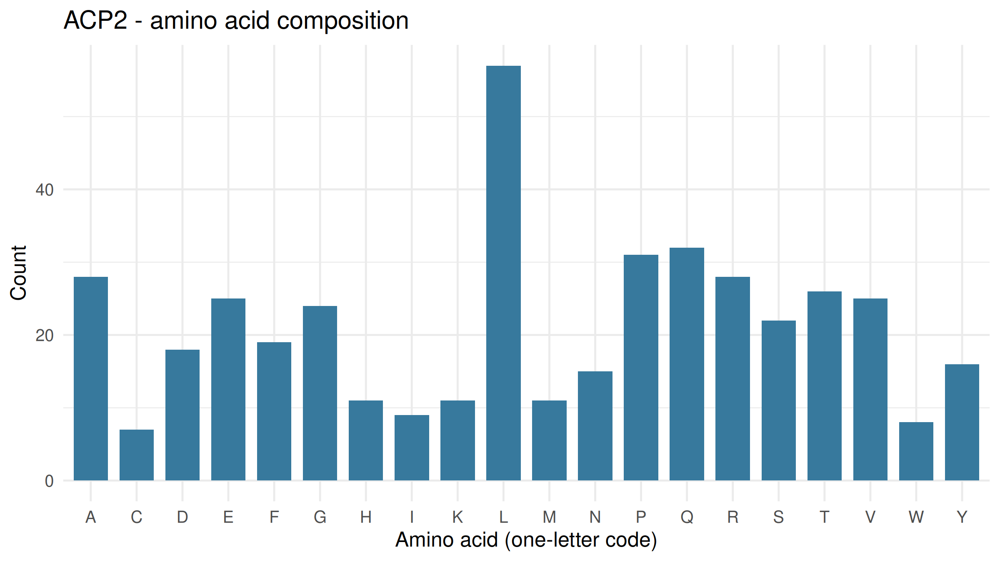

## Exploring Lysosomal Enzymes Using NCBI and R

**Gene Symbol:** ACP2
**Enzyme Name:** Lysosomal Acid Phosphatase Isoform 1 Precursor
**Organism:** *Homo sapiens*
**NCBI Protein Accession:** [NP_001601.1](https://www.ncbi.nlm.nih.gov/protein/NP_001601.1)

## Normal Function

ACP2 encodes a protein belonging to the histidine acid phosphatase family. According to NCBI, it hydrolyzes orthophosphoric monoesters into alcohol and phosphate and is localized to the lysosomal membrane.

## Materials and Software

* NCBI Protein database
* R or Posit Cloud
* R packages `rentrez` and `ggplot2`
* GitHub for storing the script, data, results, and figures

## Workflow and Results

### Step 1. Retrieve the Protein Sequence from NCBI

The human ACP2 protein sequence was retrieved from the NCBI Protein database using accession NP_001601.1. The R package `rentrez` was used to retrieve the FASTA record directly from NCBI.

The relevant R code was:

```r
fasta <- rentrez::entrez_fetch(
  db = "protein",
  id = accession,
  rettype = "fasta",
  retmode = "text"
)
```

The script checked the returned FASTA record and saved it as a file.

```r
writeLines(fasta, file.path("data", paste0(gene, ".fasta")))
```

**Output:** `data/ACP2.fasta`

**Result:** The FASTA file contains the retrieved protein record and amino acid sequence used in the analysis.

### Step 2. Analyze Protein Length and Amino Acid Composition

The downloaded sequence was processed in R to calculate the total number of amino acids and the count and percentage of each of the 20 standard amino acids.

**Outputs:**

* `results/ACP2_summary.csv`
* `results/ACP2_amino_acid_counts.csv`

**Result:** The protein contains 423 amino acids. The amino acid composition results show the count and percentage of each standard amino acid.

### Step 3. Identify Potential N-Glycosylation Motifs

The R script searched the protein sequence for the pattern N-X-S or N-X-T, where X is not proline. It recorded the starting position and sequence of each detected motif.

**Output:** `results/ACP2_motif_positions.csv`

**Result:** The analysis detected 8 potential N-glycosylation motifs. These motifs indicate possible sites of glycosylation but do not prove that glycosylation occurs.

### Step 4. Visualize Amino Acid Composition

The `ggplot2` package was used to generate a bar chart showing the frequency of each standard amino acid in ACP2.

**Output:** `figures/ACP2_amino_acid_composition.png`

**Figure 1. Amino Acid Composition**



**Result:** The bar chart compares the counts of the different amino acids. The numerical counts and percentages are available in `results/ACP2_amino_acid_counts.csv`.

### Step 5. Visualize Potential N-Glycosylation Motifs

The second figure shows the positions of the detected N-X-S/T motifs along the protein sequence.

**Output:** `figures/ACP2_potential_N_glycosylation.png`

**Figure 2. Potential N-Glycosylation Motifs**


**Result:** The figure summarizes the positions of potential N-glycosylation motifs along the protein sequence. These are predicted motifs, not experimentally confirmed glycosylation sites.

### Step 6. Review the Generated Files

The R script generates the following files:

* `data/ACP2.fasta`
* `results/ACP2_summary.csv`
* `results/ACP2_amino_acid_counts.csv`
* `results/ACP2_motif_positions.csv`
* `figures/ACP2_amino_acid_composition.png`
* `figures/ACP2_potential_N_glycosylation.png`

The script also prints the main summary and the five most common amino acids in the R Console.

## Answers to the Laboratory Questions

### 1. What does ACP2 normally break down inside lysosomes?

ACP2 hydrolyzes orthophosphoric monoesters into alcohol and phosphate. The NCBI record does not specify particular natural substrates in the information examined.

### 2. What is the total length of the protein, and which amino acids are most common?

The ACP2 protein contains 423 amino acids. Leucine (L) is the most abundant amino acid, with 57 residues (13.48%), followed by glutamine (Q) with 32 (7.57%), proline (P) with 31 (7.33%), and alanine (A) and arginine (R), each with 28 (6.62%).

### 3. How many potential N-glycosylation motifs were found, and where are they located?

The R analysis detected 8 potential N-glycosylation motifs at amino acid positions 92 (NTS), 133 (NIS), 167 (NET), 177 (NES), 191 (NET), 267 (NLT), 322 (NFS), and 331 (NES). These are predicted motifs and do not confirm actual glycosylation.

### 4. Why can glycosylation matter for lysosomal proteins? Does finding a motif prove glycosylation?

Glycosylation can contribute to protein folding, stability, trafficking, and function. However, finding an N-X-S/T motif only indicates a possible site. It does not prove that the protein is glycosylated at that position. Experimental evidence is needed for confirmation.

### 5. What could happen in the cell if ACP2 did not work properly?

The NCBI record reports lysosomal storage defects in mice lacking this gene. This observation does not by itself establish the exact effects of ACP2 dysfunction in humans.

## Conclusion

This activity demonstrates how R can retrieve a protein sequence from NCBI and analyze its length, amino acid composition, and potential N-glycosylation motifs. The results were saved as CSV files, and the figures provide visual summaries of amino acid composition and predicted motif positions. The sequence analysis identifies potential features but does not experimentally confirm glycosylation or establish a specific disease outcome.

## References

National Center for Biotechnology Information. *Lysosomal acid phosphatase isoform 1 precursor [Homo sapiens]*. NCBI Protein. Accession NP_001601.1. 

https://www.ncbi.nlm.nih.gov/protein/NP_001601.1 
